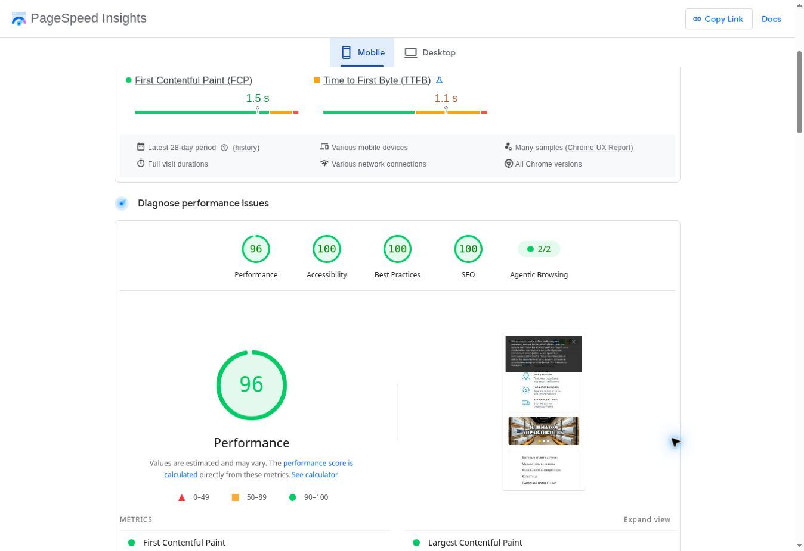

# Повторный технический аудит klimat5ervis.ru

16 ноября 2026 года, после обновления шапки и выравнивания по сетке. Исправления опубликованы на действующем сайте Timeweb; этот пакет фиксирует ту же версию.

## Результат измерений

Повторные лабораторные тесты Google PageSpeed Insights, Lighthouse 13.6.0. До — 16:21, после — 16:35 (Москва). Мобильный режим: Moto G Power, Slow 4G. Баллы зависят от условий отдельного запуска и не являются гарантией скорости всех страниц.

| Показатель главной | До повторного аудита | После |
|---|---:|---:|
| Mobile Performance | 64 | **96** |
| Desktop Performance | 92 | **97** |
| Accessibility | 94 | **100** |
| Best Practices | 96 | **100** |
| Базовое SEO Lighthouse | 100 | **100** |
| Mobile FCP | 4,7 с | **0,9 с** |
| Mobile LCP | 5,5 с | **2,2 с** |
| Mobile TBT | 0 мс | 0 мс |
| Mobile CLS | 0,052 | 0,052 |
| Mobile Speed Index | 6,7 с | **4,4 с** |
| Desktop FCP | 1,0 с | **0,3 с** |
| Desktop LCP | 1,1 с | **0,9 с** |
| Desktop TBT | 30 мс | 20 мс |
| Desktop CLS | 0,002 | 0,002 |

[Итоговый мобильный отчёт](https://pagespeed.web.dev/analysis/https-klimat5ervis-ru/m02y9ibh7g?form_factor=mobile) · [Компьютер](https://pagespeed.web.dev/analysis/https-klimat5ervis-ru/m02y9ibh7g?form_factor=desktop) · [Исходный замер](https://pagespeed.web.dev/analysis/https-klimat5ervis-ru/rvr02f2jll?form_factor=mobile).

## Исправлено

1. На главной обнаружен второй сертификат, встроенный прямо в HTML строкой data URI из 960 659 символов. Он заменён отдельным WebP с отложенной загрузкой, описанием и размерами. JPEG: 720 475 байт, WebP: 170 678 байт — на 76,3% меньше для самого изображения. Почти 1 МБ несжатой разметки больше не передаётся внутри HTML. Это не оценка экономии всего сетевого трафика с gzip.
2. Обработка длинных адресов изображений в PHP переведена на выражение без посимвольного ленивого поиска. Добавлено соответствие для сертификата.
3. jQuery и плагин количества на главной теперь загружаются с `defer`, с сохранением порядка выполнения. На страницах каталога прежний порядок сохранён для совместимости с фильтром.
4. Исправлены искажённые пропорции изображений в карточках категорий и слайдере товаров. Блоки сохраняют прежние размеры, картинки вписываются без растяжения.
5. Исправлены слабый контраст мелких подписей, текста в подвале, ссылок мессенджеров, отметок «Новинка» и кнопок. Фирменные иконки сохранены.
6. Кнопки количества увеличены до 24×24 px и отделены от поля ввода и кнопки корзины. Высота строки управления — 50 px. Проверка доступности Lighthouse выросла до 100.
7. Убрано повторение в Title специальных предложений. Для этой страницы, «О компании» и «Контакты» добавлены содержательные Title и Description. Тексты, цены и характеристики товаров не изменялись.

## Проверки сайта

В облачном Chromium проверены главная, специальные предложения, кассетные кондиционеры, вторая страница категории, товар Ballu BSO-12HN8_22Y, «О компании», контакты и поиск.

Адаптивность: главная на 12 ширинах 320, 375, 390, 576, 640, 768, 1024, 1180, 1280, 1290, 1440, 1920 px; специальные предложения, кассетная категория и товар — на шести ширинах 320, 390, 768, 1024, 1290, 1920 px. Проверка проводилась в iframe; вертикальная полоса прокрутки занимает 15 px. На этих проверках не найдено горизонтального переполнения или расхождения контейнеров шапки и контента. Дополнительно после изменения кнопок проверены мобильное меню, закрепление шапки при прокрутке и работа количества. Поиск Ballu возвращает страницу результатов с `noindex,follow`. Два слайдера главной инициализируются после переноса скриптов. Ошибок JavaScript сайта в проверке главной не найдено; сообщения расширения браузера исключены из результатов сайта.

В выборке один H1 на странице, self-canonical у страниц и отдельный canonical/Title/Description у пагинации. Новая картинка сертификата присутствует в DOM, больших встроенных data URI на главной больше нет. Проверка загруженных изображений в адаптивной выборке не выявила сломанных файлов.

Физические устройства, Safari и Firefox не использовались. Это проверка основных шаблонов, а не полный обход всех 4 649 адресов и не аудит серверной безопасности.

## Google и Яндекс

Сайт уже присутствует и подтверждён в Google Search Console и Яндекс Вебмастере; повторное добавление не требуется.

Google успешно обработал `/sitemap.xml`: 4 649 страниц, статус «Успешно». Главная присутствует в индексе; свежая проверка опубликованной страницы завершилась сообщениями «URL доступен Google» и «Эту страницу можно проиндексировать». Общие отчёты новой конфигурации ресурса ещё формируются.

[Google Rich Results Test карточки товара](https://search.google.com/test/rich-results/result?id=E7jVi-zMcxTkSeIGz8gcEQ) обнаружил четыре элемента без критических ошибок: Product, данные продавца, LocalBusiness и Organization. Есть необязательные предупреждения, в том числе отсутствие review, aggregateRating и availability. Несуществующие отзывы, рейтинги и неподтверждённые сведения о наличии не добавлялись.

Яндекс показывает сбой обновления данных. Раздел Sitemap явно работает в режиме «Только для чтения»; добавление и отправка на переобход отключены самим сервисом. Старые счётчики дубликатов Title/Description и ошибка старой карты не подтверждают текущее состояние после правок. Повторно отправить Sitemap сейчас невозможно; после восстановления сервиса потребуется свежая проверка отчётов.

## Что ещё требует внимания

Lighthouse остаётся рекомендовать адаптивные размеры отдельных изображений (около 121 KiB в мобильном тесте), минификацию небольших фрагментов CSS/JS и сокращение примерно 33 KiB JavaScript, не использованного в одном сценарии. Это не доказательство, что библиотеки лишние для каталога, фильтров, модальных окон и корзины. Их массовое удаление без проверки всех сценариев не выполнялось. Для исторических дубликатов SEO нужен актуальный список URL после обновления данных Вебмастера. Полевая оценка Core Web Vitals пока не имеет полного набора данных.

## Установка и откат

[Пакет](klimat5ervis-reaudit-2026-11-16.zip) содержит только пять изменённых/новых файлов: шаблон, PHP-помощник, карту изображений, CSS и WebP. Применять поверх последнего [пакета шапки](klimat5ervis-header-2026-11-16.zip). Проверочная страница в пакет не включена.

[Diff](reaudit-2026-11-16.patch) и [SHA-256](reaudit-manifest-2026-11-16.json) фиксируют изменения. Для отката восстановить четыре предыдущих файла из [архива отката](reaudit-rollback-2026-11-16.zip); новый WebP после отката перестанет подключаться. Секреты и база данных в этих архивах отсутствуют. Автоматическое развёртывание не добавлялось: файлы применены через файловый менеджер и проверены на действующем сайте.
