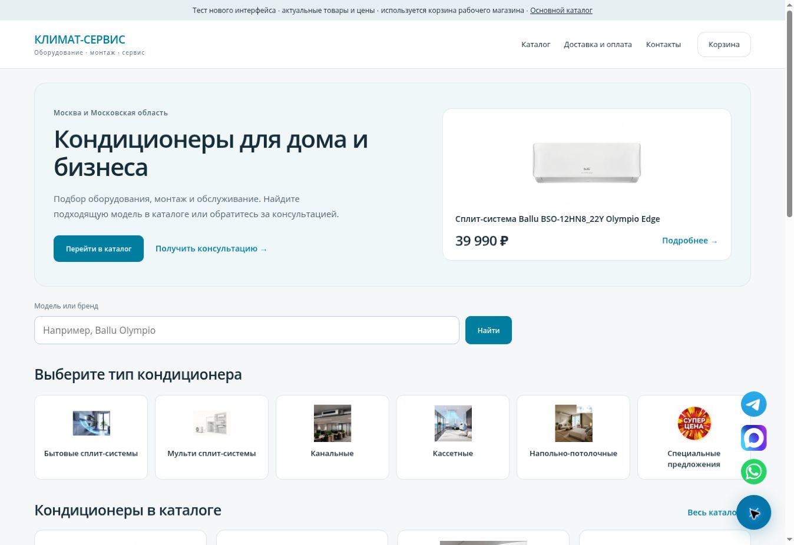

# Климат-Сервис: тест современной витрины

[Открыть новую главную](https://klimat5ervis.ru/modern-home/) · [Каталог](https://klimat5ervis.ru/modern-catalog/) · [Корзина](https://klimat5ervis.ru/modern-cart/)

**Состояние на17.11.2026:** новая главная, каталог/товары с нативными ценами и техническими фильтрами, современная корзина на существующем HostCMS. Оформление пока продолжает существующий сценарий магазина. Полная модернизация PHP, кэша, изображений и перенос ещё не завершены.

[Текущая реализация, проверка и оставшаяся работа](STATUS-2026-11-17.md) · [Конкурентный UX-обзор](COMPETITOR-UX-2026-11-17.md)

## Исходники

- ModernHome2026.xsl + home-structure-source.php + home-structure-config.php — тестовая главная.
- ModernCatalog2026.xsl + structure-source.php + structure-config.php — каталог, категории и товары.
- ModernCart2026.xsl + cart-structure-source.php + cart-structure-config.php — корзина.
- template3.php + messenger-widget.html — согласованное облачко мессенджеров рабочего сайта.

Все изменения сделаны через облачный браузер в HostCMS и сохранены в этой ветке. Рабочие / и /category/ не переключены на новую витрину.

## История

HOSTCMS-LIVE-CATALOG.md — предыдущий этап каталога/товаров16.11.2026. MESSENGER-2026-11-17.md — блок мессенджеров. index.html и responsive.html — ранний статический прототип на new.klimat5ervis.ru; он не является текущим динамическим магазином.

Откатные копии и история коммитов сохранены. На тестовых страницах общий HTML-кэш отключён, индексация запрещена; используется реальная корзина данного браузера. Заказы и платежи в ходе проверки не отправлялись.
